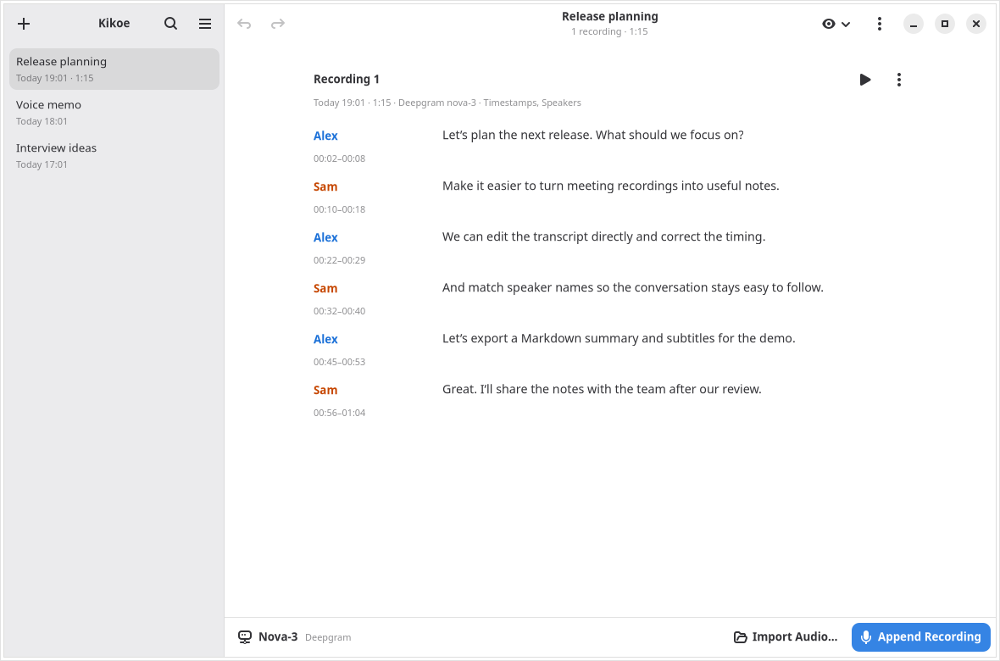
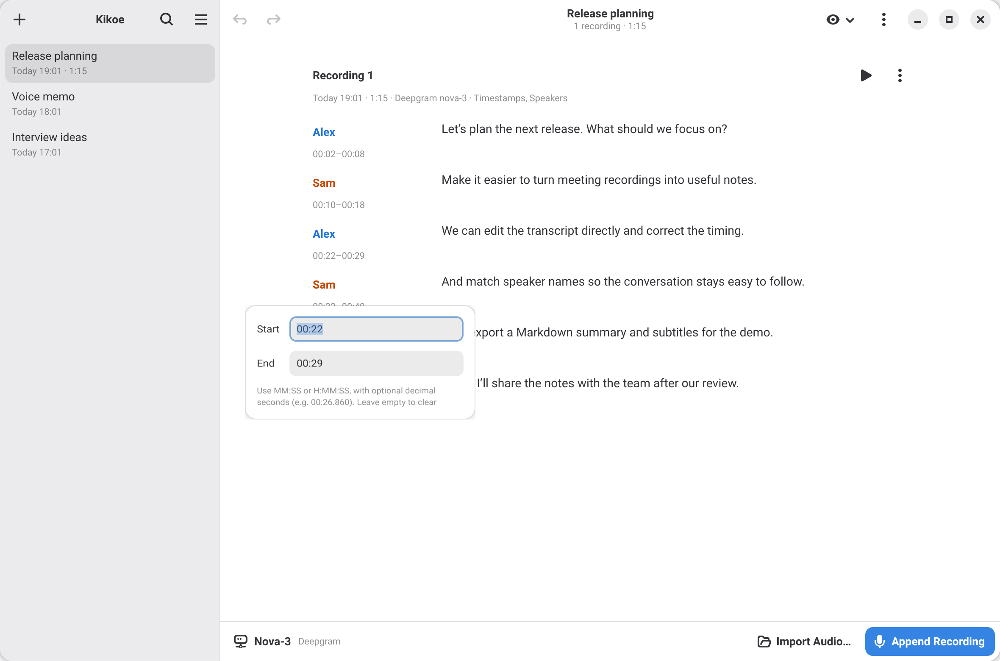
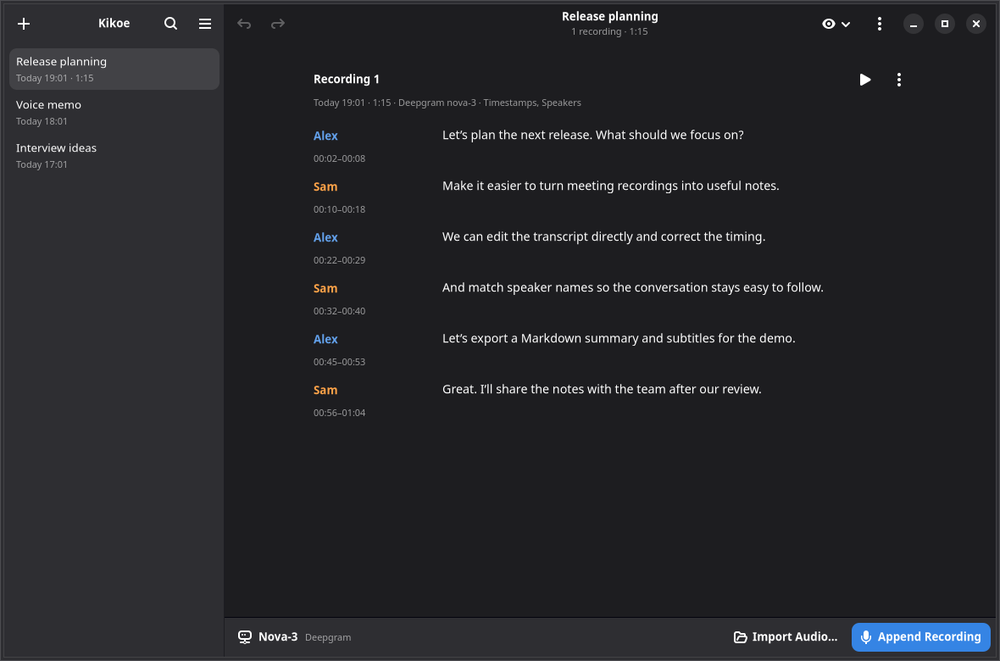

<p align="center">
  
</p>

# Kikoe

**Your conversations, turned into useful notes.**

Record a meeting, import an interview, or capture a voice memo. Kikoe turns audio
into searchable, editable notes with cloud speech-to-text services or models that
run on your own computer.

[Get started](#-get-started) · [Transcription tips](#transcription-tips) · [Contribute](#-development)



## ✨ Capture, refine, share

- 🎙️ **Record or import** — microphone capture with pause/resume, plus existing audio files.
- ☁️ **Choose your service** — Deepgram, OpenAI, OpenRouter, Gemini AI Studio, MiMo, Groq, Mistral, an OpenAI-compatible API, or any audio-capable LLM with your own transcription prompt.
- 💻 **Or stay offline** — download Whisper, Fun-ASR, Parakeet or Voxtral models in Preferences → Local Models; they run with [transcribe.cpp](https://github.com/handy-computer/transcribe.cpp) on Vulkan, CUDA, Metal or the CPU.
- 👥 **Follow each voice** — optional timestamps, speaker labels, and matching across recordings.
- ✏️ **Polish your notes** — edit text and timestamps in place, with Undo/Redo; search titles and transcripts.
- 📤 **Take them anywhere** — export text, Markdown, SRT, WebVTT, or original audio. Subtitles need timestamps.

Built with Python 3.14, GTK 4, and libadwaita ≥ 1.8, with adaptive layouts,
light/dark themes, and Simplified Chinese.

> **Linux first; still in development.** macOS and Windows packaging is planned.
> Cloud transcription requires a provider API key; local models need no account. Real provider accounts and
> macOS/Windows realtime capture are not yet verified.

## 📸 A closer look

<table>
  <tr>
    <td width="50%"></td>
    <td width="50%"></td>
  </tr>
  <tr>
    <td align="center"><strong>Fine-tune the timing</strong><br>Edit segment timestamps beside the text.</td>
    <td align="center"><strong>Settle into dark mode</strong><br>The same notes, in your preferred theme.</td>
  </tr>
</table>

Fresh Linux captures of the current app, using synthetic notes and speaker names.

## 🚀 Get started

Packages for Linux (Flatpak, AppImage), macOS (`.dmg`) and Windows (installer or
portable zip), for x86-64 and ARM, are attached to each
[release](https://github.com/first-storm/Kikoe/releases); see
[docs/packaging.md](docs/packaging.md) for requirements. On Linux, the Flatpak
repository also delivers updates:

```sh
flatpak remote-add --user --if-not-exists kikoe https://first-storm.github.io/Kikoe/kikoe.flatpakrepo
flatpak install --user kikoe io.github.first_storm.Kikoe
```

To run from source instead,
install [uv](https://docs.astral.sh/uv/), GTK 4, libadwaita ≥ 1.8, ffmpeg, and PortAudio.
Building PyGObject needs `girepository-2.0` (GLib ≥ 2.80), Cairo headers,
`pkg-config`, and a C compiler. uv installs Python 3.14 if needed.

<details>
<summary>System packages by platform</summary>

Choose a release with the required library versions. GNU gettext is needed for translations.

| Platform | Command |
| --- | --- |
| openSUSE | `sudo zypper in gtk4 libadwaita-1 typelib-1_0-Adw-1 cairo-devel glib2-devel ffmpeg gettext-tools libportaudio2` |
| Fedora | `sudo dnf install gtk4 libadwaita cairo-devel gobject-introspection-devel ffmpeg-free gettext portaudio` |
| Debian/Ubuntu | `sudo apt install gir1.2-gtk-4.0 gir1.2-adw-1 gir1.2-girepository-3.0 libgirepository-2.0-dev libcairo2-dev pkg-config ffmpeg gettext libportaudio2` |
| macOS (Homebrew) | `brew install gtk4 libadwaita gobject-introspection pkg-config ffmpeg gettext portaudio` |
| Windows (MSYS2 UCRT64) | `pacman -S mingw-w64-ucrt-x86_64-{gtk4,libadwaita,gobject-introspection,cairo,pkgconf,gcc,ffmpeg,gettext,portaudio}` |

</details>

From the repository directory:

```sh
uv sync
uv run scripts/build_ui.py
uv run kikoe
```

1. **Connect a provider.** Add your API key and a model in Preferences, or download a local engine and model under Local Models.
2. **Start a note.** Record your microphone or import audio with a file model.
3. **Make it useful.** Review the text, name speakers, and export from the note menu.

**Shortcuts:** Ctrl+N creates a note · Ctrl+O imports audio · Ctrl+F searches · F2 renames.
Kikoe remembers the last selected model. Preferences → General sets a language hint; leave it empty for automatic detection.

### Transcription tips

<details>
<summary>Models, recovery, and re-transcription</summary>

- **Model support varies.** Deepgram Nova-3 supports file/live transcription, timestamps, and speakers. Groq Whisper supports file transcription with timestamps. Mistral Voxtral (including the Voxtral 3 models, with custom vocabulary) supports file transcription with timestamps, speakers and streaming previews (the transcription language is ignored while timestamps or speakers are on), and its realtime model is microphone-only text. OpenRouter and MiMo support file transcription (MiMo returns plain text without timestamps or speakers); Audio LLM providers prompt any chat model that accepts audio, in OpenAI-compatible or Gemini format, and return plain text; OpenAI, Gemini and Mistral also offer live models, with unsupported options disabled.
- **Live-only models need a file alternative.** `gpt-live-transcribe`, `gemini-3.5-transcribe-live` and `voxtral-mini-transcribe-realtime-2602` and `voxtral-mini-transcribe-realtime-3-0` are microphone-only; choose a file model for imports or retries.
- **Audio stays available.** Recordings are saved locally. Interruptions retain audio and confirmed text; recovery never uploads automatically. Use **Retry Transcription** with a file model.
- **Keep speakers consistent.** Click names to rename them; **Match Speakers** links people across recordings, with audio samples when timing allows.
- **Try another model.** The recording menu offers playback and **Re-transcribe**. A successful result replaces that recording’s text, including manual edits; failure or cancellation keeps the previous text and audio.

</details>

## 🛠️ Development

Read [AGENTS.md](AGENTS.md) before contributing. Rebuild templates after changing `.blp` files.
Run the required checks:

```sh
uv run ruff format --check && uv run ruff check && uv run scripts/build_ui.py --check \
  && uv run scripts/build_ui.py && uv run pyright && uv run pytest
```

Use `KIKOE_LOG_LEVEL=DEBUG` for local diagnostics; Preferences → General opens the logs.
Logs rotate at 2 MiB with three backups and redact dynamic text and credentials.
Set `KIKOE_FFMPEG` if ffmpeg is outside `PATH`.

[Architecture](docs/architecture.md) · [UI design](docs/design.md) · [Packaging](docs/packaging.md) · [Translations](po/README.md)

## License

[GPL-3.0-or-later](LICENSE).
